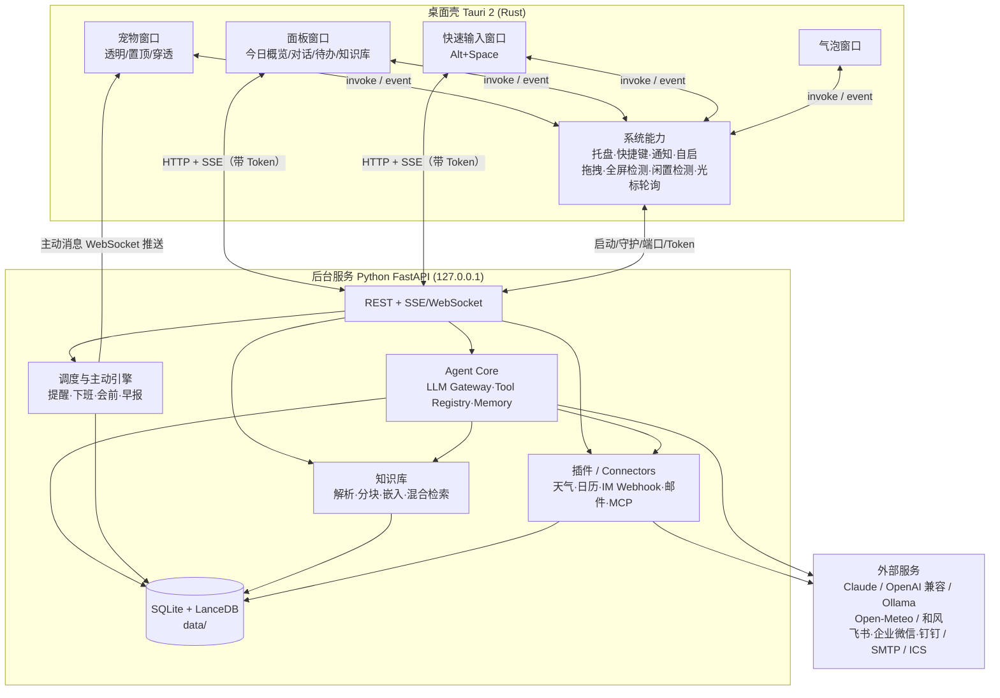

# 03 · 技术方案

> ⚠️ 本文是设计阶段方案。v0.1 实际采用 **Electron + 单进程 Node**（本机无 Rust/MSVC 工具链），详见 [06-实现说明](../%E5%BC%80%E5%8F%91%E8%AE%B0%E5%BD%95/06-%E5%AE%9E%E7%8E%B0%E8%AF%B4%E6%98%8E.md)。

## 1. 技术选型

### 1.1 桌面壳对比

| 方案 | 内存（空闲） | 透明/穿透/置顶 | 开发效率 | 生态 | 结论 |
|---|---|---|---|---|---|
| **Tauri 2**（Rust + WebView2） | 低（约 30–80MB） | 支持；穿透需少量 Rust | 前端技术栈，高 | 官方插件齐全 | ✅ **选用** |
| Electron | 高（约 150–300MB） | 支持完善 | 最高 | 最成熟 | 备选：若团队无 Rust 经验 |
| WPF / WinUI 3（C#） | 低 | 原生最好 | 中 | Windows 专属 | 只做 Windows 且熟 C# 可选（VPet 路线） |
| PySide6（Qt） | 中 | 支持 | 中 | 与 AI 同语言 | UI 精致度和动画表现弱于 Web |

**理由**：常驻桌面的程序必须"轻"，Tauri 的内存优势明显；UI 用 Web 技术可以快速做出精致面板和动画；Windows 11 自带 WebView2，无需打包浏览器内核。

### 1.2 AI 后端语言

选择 **Python 作为 Sidecar 后台服务**，原因：文档解析（MarkItDown/Docling）、向量库、LLM SDK、MCP SDK、调度器的生态都以 Python 最成熟。Rust 只负责"系统能力"，不写业务。

### 1.3 最终技术栈

| 层 | 技术 |
|---|---|
| 桌面壳 | Tauri 2（Rust）+ 插件：`tray-icon`、`global-shortcut`、`notification`、`autostart`、`single-instance`、`window-state`、`updater`、`shell`（sidecar）、`fs`、`dialog` |
| 前端 | React 18 + TypeScript + Vite + TailwindCSS + Zustand（状态）+ TanStack Query（请求缓存） |
| 宠物渲染 | 序列帧 Sprite（默认，最省资源）/ Lottie / pixi-live2d-display（可选 Live2D） |
| 后台服务 | Python 3.12 + FastAPI + Uvicorn，PyInstaller 打包为单文件 sidecar |
| LLM | Anthropic SDK（Claude）+ OpenAI SDK（兼容 DeepSeek / 通义 / Kimi / Ollama 等） |
| Agent | 自研轻量 Tool Loop + MCP Python SDK（客户端 + 服务端） |
| 调度 | APScheduler（SQLite JobStore 持久化） |
| 存储 | SQLite（业务数据）+ LanceDB（向量）+ SQLite FTS5（全文） |
| 文档解析 | MarkItDown（默认）、Docling（复杂 PDF）、RapidOCR（图片/扫描件） |
| Embedding | 默认本地 `bge-m3`（经 Ollama），可切换云端 Embedding API |
| 密钥 | `keyring`（Windows 凭据管理器） |
| 日志 | loguru（Python）/ tracing（Rust），落到 `data/logs/` |

---

## 2. 总体架构



### 2.1 进程模型

1. 用户启动 `PersonalAgent.exe`（Tauri）。
2. Rust 生成随机端口 + 随机 Token，以 sidecar 方式启动 `agent-server.exe --port X --token Y --data-dir ./data --config-dir ./config`。
3. 健康检查通过后把 `{port, token}` 通过 Tauri 事件下发给各前端窗口。
4. sidecar 崩溃 → Rust 侧守护重启（指数退避，最多 5 次后提示用户）。
5. 退出时 Rust 先调用 `/shutdown` 优雅关闭，再兜底 kill。

### 2.2 通信约定

| 方向 | 方式 | 用途 |
|---|---|---|
| 前端 ↔ Rust | Tauri `invoke` / `emit` | 窗口控制、文件路径、系统能力 |
| 前端 → Python | HTTP REST（`Authorization: Bearer <token>`） | 业务 CRUD |
| 前端 ← Python | SSE | 对话流式输出 |
| Python → 前端 | WebSocket `/ws/events` | 主动推送：提醒、入库进度、宠物状态切换 |

只监听 `127.0.0.1`，Token 每次启动随机生成，防止本机其它程序调用。

---

## 3. 桌面窗口层设计（Rust + 前端）

### 3.1 窗口清单

| 窗口 label | 属性 | 说明 |
|---|---|---|
| `pet` | `transparent`、`decorations:false`、`alwaysOnTop`、`skipTaskbar`、`shadow:false`、`resizable:false` | 宠物本体 |
| `bubble` | 同上，`focus:false` | 气泡，跟随宠物位置；独立窗口可避免宠物窗口尺寸频繁变化 |
| `panel` | 无边框、圆角、Mica/Acrylic 背景（`window-vibrancy` crate）、默认隐藏 | 主面板，失焦可自动收起（可配置） |
| `quick` | 无边框、居中、失焦隐藏 | 快速输入，类 Spotlight |

### 3.2 透明区域点击穿透

Tauri 的 `setIgnoreCursorEvents(true)` 作用于整个窗口，需要配合"命中测试"：

1. 默认 `ignore = true`（整窗穿透）。
2. Rust 侧以 30–60ms 间隔轮询全局光标位置（`GetCursorPos`），判断是否落在宠物窗口矩形内。
3. 若在矩形内，向前端询问/或在 Rust 侧用当前帧的 **alpha 掩码**（前端每次换动画时上报低分辨率掩码）判断该点是否不透明。
4. 落在不透明像素 → `ignore = false`（可点击/拖动）；离开 → `ignore = true`。
5. 拖动中强制 `ignore = false`。

> 参考 BongoCat / Open-LLM-VTuber 桌宠模式的实现。

### 3.3 拖动与吸附

- 前端 `mousedown` → `appWindow.startDragging()`，系统原生拖动最流畅。
- 监听 `Moved` 事件，松手后计算距离屏幕工作区（排除任务栏）各边距离，< 24px 时吸附；可"半隐藏"在边缘。
- 使用 `window-state` 插件按显示器保存位置；启动时校验位置是否仍在可见显示器内，否则复位到主屏右下角。

### 3.4 文件拖拽上传

- Tauri 2 的 WebView 拖放事件 `onDragDropEvent`（`enter / over / drop / leave`）可直接拿到**文件绝对路径**，无需把文件内容经过前端。
- 拖入时宠物切换 `drag_hover` 动画（张嘴）；`drop` 后弹出目标选择小菜单：
  - 📚 收进知识库（默认，可在设置里设为不询问）
  - 📎 附加到任务
  - ✨ 让 AI 总结
- 前端把路径列表 POST 给 `/api/kb/ingest`；后台**复制**文件到 `data/uploads/YYYY/MM/`（保留原文件不动），异步解析，进度经 WebSocket 回推。
- 支持：文件、多文件、文件夹（递归，遵守忽略规则）、从浏览器拖来的 URL / 文本（走 HTML5 `dataTransfer`）。

### 3.5 系统感知（Rust 实现，事件上报给后台）

| 能力 | Windows API | 用途 |
|---|---|---|
| 全屏/演示检测 | `SHQueryUserNotificationState` | 全屏、演示模式时静默 |
| 闲置时长 | `GetLastInputInfo` | 宠物睡觉；久坐提醒按实际活跃时间算 |
| 锁屏/解锁 | `WTSRegisterSessionNotification` | 解锁时打招呼 / 补发错过的提醒 |
| 当前前台窗口标题（可选、默认关闭） | `GetForegroundWindow` | 远期：上下文感知 |

### 3.6 宠物动画与皮肤包

**状态机**：

```
            ┌──────── 拖拽 ────────┐
            ▼                      │
 sleep ◄─ idle ─► walk          drag
   ▲       │ ▲
   │       ▼ │
 闲置>N分  think ─► talk ─► idle
           alert（提醒） / happy（完成任务） / eat（吃文件）
```

- 每个状态支持 `start → loop → end` 三段式（借鉴 VPet），保证过渡自然。
- 业务事件 → 状态映射在 `assets/pets/<name>/pet.json` 中配置。
- 渲染：默认 Canvas 序列帧（WebP 精灵图）；失焦或被遮挡时降到 10fps；隐藏时停止渲染。

---

## 4. 后台服务层设计（Python）

### 4.1 模块划分

```
services/agent/
├── app/
│   ├── main.py              # FastAPI 入口、生命周期、鉴权中间件
│   ├── api/                 # 路由：chat / tasks / events / reminders / kb / notes / weather / channels / settings / ws
│   ├── core/
│   │   ├── config.py        # 读取 config/*.yaml，环境变量覆盖，热重载
│   │   ├── db.py            # SQLite（SQLModel/SQLAlchemy）、迁移（Alembic）
│   │   ├── events.py        # 进程内事件总线 + WebSocket 广播
│   │   └── secrets.py       # keyring 封装
│   ├── llm/
│   │   ├── gateway.py       # 统一接口：chat / stream / tool_call / embed
│   │   └── providers/       # anthropic.py / openai_compat.py / ollama.py
│   ├── agent/
│   │   ├── loop.py          # Tool-use 循环（最多 N 轮）、确认拦截
│   │   ├── tools.py         # Tool 注册表（JSON Schema 自动从函数签名生成）
│   │   ├── memory.py        # 会话记忆 + 用户画像记忆
│   │   └── prompts.py       # 加载 config/prompts/*.md
│   ├── scheduler/
│   │   ├── jobs.py          # APScheduler 初始化
│   │   └── proactive.py     # 主动引擎：规则 → 消息 → 投递策略
│   ├── kb/
│   │   ├── ingest.py        # 解析 → 清洗 → 分块 → 嵌入 → 入库
│   │   ├── parsers.py       # MarkItDown / Docling / OCR 适配
│   │   ├── chunker.py       # 按标题层级 + 长度切分（含重叠）
│   │   └── retriever.py     # 向量 + BM25 混合检索、RRF 融合、可选重排序
│   └── plugins/             # 内置插件：weather / calendar / tasks / reminder / knowledge / messenger / report
└── tests/
```

### 4.2 Agent 设计

**Tool Loop（伪代码）**：

```python
async def run(conversation, user_msg):
    ctx = build_context(user_profile, today_snapshot, conversation.history)
    for _ in range(MAX_STEPS):            # 默认 8
        resp = await llm.chat(system=SYSTEM_PROMPT, messages=ctx, tools=registry.schemas())
        stream_text_to_client(resp)
        if not resp.tool_calls:
            break
        for call in resp.tool_calls:
            tool = registry[call.name]
            if tool.requires_confirm:      # 外发/删除类
                ok = await ask_user_confirm(preview=tool.preview(call.args))
                if not ok:
                    ctx.append(tool_result(call, "用户取消")); continue
            ctx.append(tool_result(call, await tool.run(**call.args)))
```

**上下文注入（每轮对话都带"今日快照"）**：当前时间、星期、是否工作日、距下班时间、今日日程摘要、今日任务数 —— 让模型能回答"我下午还有空吗"这类问题而无需额外调用工具。

**内置工具（首批）**：

| Tool | 说明 | 需确认 |
|---|---|---|
| `get_weather(city?, days?)` | 天气 | 否 |
| `list_events(date_from, date_to)` / `create_event(...)` / `update_event` | 日程 | 否 |
| `list_tasks(filter)` / `create_task(...)` / `complete_task(id)` | 任务与待办 | 否 |
| `delete_task(id)` / `delete_event(id)` | 删除 | **是** |
| `create_reminder(when, text, repeat?)` | 提醒（支持自然语言时间，由模型转为 ISO/cron） | 否 |
| `search_knowledge(query, top_k)` | 知识检索，返回片段 + 出处 | 否 |
| `save_note(title, content, tags)` | 随手记 | 否 |
| `send_message(channel, content, format)` | 发送到 IM / 邮件 | **是** |
| `generate_report(kind=daily/weekly, date)` | 汇总素材生成日报/周报草稿 | 否 |
| `remember(fact)` / `forget(fact_id)` | 长期记忆 | 否 |

**模型路由**：`config/llm.yaml` 中按用途配置——`chat`（主对话）、`fast`（意图识别 / 打标签 / 摘要等便宜任务）、`embedding`、`offline_fallback`（无网时的本地模型）。

### 4.3 主动引擎（Proactive Engine）

```
触发源 Trigger ──► 规则 Rule ──► 消息 Message ──► 投递策略 Delivery
 · 定时(cron)       · 条件判断      · 文案(模板/LLM)    · 宠物气泡
 · 日程开始前N分     · 去重/频控     · 动画状态          · 系统通知
 · 系统事件(解锁/闲置)· 免打扰检查   · 操作按钮          · IM 推送（离开电脑时）
 · 数据事件(任务逾期)
```

- **免打扰**：全屏/演示中、用户设置的勿扰时段、会议进行中 → 气泡降级为托盘通知或延后。
- **频控**：同类主动消息 N 分钟内只出一次；用户点"不再提醒"写入规则。
- **漏发补偿**：电脑睡眠/关机错过的提醒，下次启动或解锁时汇总一次提示（APScheduler `misfire_grace_time` + 补偿逻辑）。
- **工作日历**：内置中国法定节假日/调休数据（`config/holidays/` 每年更新，或接入在线节假日 API），下班提醒、早报仅在工作日触发。

### 4.4 知识库流水线

```
拖入/监听/URL
   │
   ▼
复制到 data/uploads/YYYY/MM/，计算 sha256 去重
   │
   ▼
解析：MarkItDown（docx/xlsx/pptx/pdf/html/图片）→ 失败或扫描件 → Docling / RapidOCR
   │
   ▼
清洗：去页眉页脚、合并断行、表格转 Markdown
   │
   ▼
分块：按 Markdown 标题层级切分，单块 400–800 token，重叠 80；每块保留 标题路径 + 页码
   │
   ▼
增强（异步，fast 模型）：文档摘要、自动标签、可能的待办抽取
   │
   ▼
嵌入：bge-m3（本地 Ollama）或云端 Embedding API
   │
   ▼
存储：LanceDB（向量）+ SQLite FTS5（全文）+ documents/chunks 元数据表
```

**检索**：向量召回 top 20 + BM25 召回 top 20 → RRF 融合 → （可选）重排序 → top 6 交给 LLM；回答时要求逐句标注 `[n]` 引用，前端渲染为可点击出处（打开原文件并定位页码）。

### 4.5 连接器（Connectors）

| 能力 | 方案 |
|---|---|
| 天气 | Open-Meteo（默认，免 Key）；和风天气（国内更准）；缓存 30 分钟 |
| 日历 | 本地 SQLite；ICS 订阅（`icalendar` 解析，定时拉取）；Microsoft Graph（OAuth 设备码登录）；飞书/钉钉开放平台 |
| IM 发送 | 飞书 / 企业微信 / 钉钉**群机器人 Webhook**（含签名校验）；后续可接应用机器人发给个人 |
| 邮件 | SMTP（`aiosmtplib`）|
| 系统通知 | Tauri notification 插件（Windows Toast） |
| MCP | 客户端：读取 `config/mcp.yaml` 启动外部 MCP Server；服务端：暴露 tasks/events/notes/search 工具，供 Claude Code 等使用 |

### 4.6 插件规范

```yaml
# plugins/<name>/plugin.yaml
name: jira
version: 0.1.0
description: 同步 Jira 中分配给我的 Issue 到今日任务
entry: plugin.py            # 暴露 register(ctx) 函数
permissions: [network, tasks.write]
config_schema:              # 设置界面自动生成表单
  base_url: {type: string}
  token: {type: secret}
provides:
  tools: [jira_list_my_issues, jira_transition]
  triggers: [{cron: "*/30 9-18 * * 1-5", handler: sync}]
  cards: [jira_today]       # 可选：面板卡片（前端以 Web Component 加载）
```

---

## 5. 安全与隐私

1. API Key、Webhook、SMTP 密码存 **Windows 凭据管理器**；yaml 中只写引用 `secret://llm/anthropic`。
2. 后台只监听 `127.0.0.1` + 随机 Token。
3. 外发动作（发消息、发邮件、删除）**必须确认**；确认卡片展示完整内容和目标。
4. 可配置"敏感信息脱敏"：发往云端模型前替换手机号、身份证、内部域名等（正则规则在 `config/app.yaml`）。
5. 知识库可设置"仅本地模型"空间，该空间内容永不发往云端。
6. 插件声明权限，首次启用时提示用户。
7. 日志不记录对话正文与密钥（可在调试模式开启）。

## 6. 性能策略

- 宠物窗口只做渲染；失焦降帧、隐藏停帧；精灵图使用 WebP。
- 面板窗口默认隐藏但**预创建**，展开 < 150ms。
- Python 后台懒加载重型依赖（Docling、OCR、Embedding 模型仅在首次使用时加载）。
- 知识入库放后台任务队列，单并发，避免卡顿；空闲时再处理大文件。

## 7. 打包与发布

- `tauri build` → NSIS 安装包；Python 用 PyInstaller 打包为 `agent-server-x86_64-pc-windows-msvc.exe`，通过 `bundle.externalBin` 随包分发。
- 用户数据目录：默认安装目录下 `data/`（便携模式），或 `%APPDATA%\PersonalAgent\data`（安装模式），在 `config/app.yaml` 中 `paths.data_dir` 指定。
- 自动更新：Tauri updater + GitHub Releases。
- 代码签名：避免 SmartScreen 拦截（发布阶段处理）。

## 8. 开发环境

| 工具 | 版本 |
|---|---|
| Node.js | 20 LTS+，包管理 pnpm |
| Rust | stable（MSVC 工具链） |
| Python | 3.12，包管理 uv |
| WebView2 | Windows 11 自带 |
| Ollama（可选） | 本地模型与 Embedding |

开发时：`pnpm tauri dev` 启动前端与壳；`uv run uvicorn app.main:app --reload` 单独启动后台（开发模式下 Rust 不拉起 sidecar，读取 `config/.env` 中的固定端口与 Token）。
